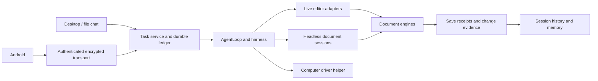

# Architecture

The Electron Shell owns document tabs, provider settings and trusted IPC. Editor renderers own live document models. AI BigDog orchestrates tools through the shared AgentLoop and approval boundaries.

## Ownership

- A Session owns conversation and memory. A Task owns a goal, steps, budget and receipts. An Attempt is execution on a particular host.
- An open editor owns unsaved state. Headless edits must be saved through the normal save path before handing the file to an editor.
- Tool completion, saved output and verified output are distinct. Unknown effects require reconciliation before retry; imported history does not grant authority.
- Session deletion goes through a recycle bin. Permanent destruction is a user action, and original user documents are not Session cache.
- Screenshots for computer tools are bounded run context. An input action requires a subsequent observation before declaring its effect verified.

## Source map

| Module | Entry |
|---|---|
| Shell and IPC | `apps/shell/src/main/index.ts` |
| Global Agent and Office tools | `apps/shell/src/main/workspace-agent/` |
| Durable execution | `apps/shell/src/main/agent-tasks/` |
| Loop, budget and compaction | `packages/agent-core/src/` |
| Session storage and shared service | `packages/project-store/src/` |
| DOCX/PPTX/format conversion | `packages/*-engine`, `packages/*2*`, `packages/file-parse` |
| XLSX native sidecar | `apps/sheets/native/xlsx-engine/` |
| Host/mobile consistency | `apps/shell/src/main/mobile-host/`, `packages/remote-core/` |
| Computer observation/input | `packages/computer-use/` |

The desktop must be running to execute tasks. Remote queues can hold encrypted requests while it is offline. Session handoff is for idle/terminal sessions; running tools and unsaved editor models do not migrate between hosts.
